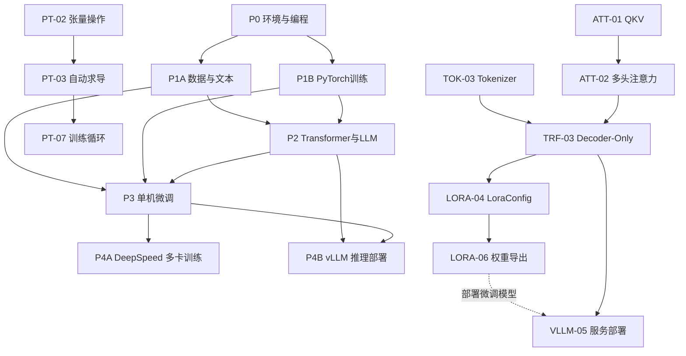

# 大模型学习知识图谱与个性化规划设计（知识点级）

## 0. 文档定位

本设计用于“从零基础到微调和部署推理大模型”的个性化学习 Agent。

- **展示层**：按阶段和板块组织，用户能看懂当前在学什么。
- **决策层**：以 73 个原子知识点为最小单位，Agent 据此诊断、跳过、复习、解锁和排期。
- **原则**：板块不是推荐最小单位；知识点才是。板块仅负责导航、汇总和阶段成就。
- **总理论时长**：71.5h。实际学习应依据用户测评和练习量动态调整。

## 1. 分层架构

```text
Phase（阶段）
  └─ Module（板块）
      └─ KnowledgeNode（原子知识点）
          ├─ dependency（依赖边）
          ├─ mastery_check（掌握验证）
          ├─ resource_requirement（资源条件）
          └─ status（用户学习状态）
```

### 1.1 阶段和板块

|阶段|名称|板块|目标|理论时长|
|---|---|---|---|---:|
|P0|环境与编程基座|M01 Linux；M02 Python|能管理环境、读写和排错代码|13.5h|
|P1|数据与训练基础|M03 数据处理；M04 PyTorch；M05 NLP；M06 Tokenizer|能构造模型输入和基础训练流程|23h|
|P2|Transformer与LLM原理|M07 注意力；M08 Transformer；M09 LLM特性|理解大模型工作和推理边界|10.5h|
|P3|单机微调实践|M10 三阶段训练；M11 HuggingFace；M12 LoRA/QLoRA；M13 训练优化|完成可复现的微调|19h|
|P4|规模化训练与部署|M14 DeepSpeed；M15 vLLM|多卡训练或高性能部署|10h|

### 1.2 板块通关逻辑

- 板块内知识点标记为 `required`、`recommended`、`optional`。
- 仅当所有 `required` 节点通过掌握验证，板块才标记为 `mastered`。
- `recommended` 未通过时不阻塞后续，但计划中保留为复习债务。
- `optional` 仅在用户目标或硬件条件匹配时出现。
- P1 中 M03/M05/M06（数据与文本）和 M04（PyTorch）可并行；二者共同为 P2/P3 提供基础。

## 2. 原子知识点目录（73个）

字段说明：`硬前置`表示未掌握不可进入；`推荐前置`表示建议先学；`资源`为实操所需最低条件。

### M01 Linux环境与命令行操作（3.5h）

|ID|知识点|h|级别|硬前置|掌握验证|资源|
|---|---|---:|---|---|---|---|
|LIN-01|Linux/WSL2/云服务器与终端准备|0|required|-|能进入终端并执行命令|CPU|
|LIN-02|Shell命令：cd、ls、mkdir、cp、mv|1|required|LIN-01|完成目录创建、复制、移动|CPU|
|LIN-03|环境变量配置|1|required|LIN-02|设置并验证一个环境变量|CPU|
|LIN-04|conda/pip虚拟环境管理|1|required|LIN-02|创建环境并安装指定包|CPU|
|LIN-05|nvidia-smi显存监控|0.5|recommended|LIN-01|识别GPU、驱动和显存占用|NVIDIA GPU|

### M02 Python编程基础（10h）

|ID|知识点|h|级别|硬前置|掌握验证|资源|
|---|---|---:|---|---|---|---|
|PY-01|Python/IDE/镜像源环境准备|0|required|LIN-04|创建可运行Python项目|CPU|
|PY-02|Python语法|2|required|PY-01|编写条件、循环和模块导入|CPU|
|PY-03|Python数据结构|2|required|PY-02|用列表、字典处理样本数据|CPU|
|PY-04|函数、类与对象|2.5|required|PY-03|封装一个可复用数据处理类|CPU|
|PY-05|文件与异常处理|1.5|required|PY-03|安全读取JSON并处理异常|CPU|
|PY-06|装饰器与生成器|2|recommended|PY-04|解释生成器迭代和简单装饰器|CPU|

### M03 数据处理基础（3.5h）

|ID|知识点|h|级别|硬前置|掌握验证|资源|
|---|---|---:|---|---|---|---|
|DATA-01|Pandas/NumPy/Matplotlib/re环境准备|0|required|PY-01|成功导入所需库|CPU|
|DATA-02|Pandas数据清洗|1|required|PY-03,DATA-01|清洗缺失、重复和异常记录|CPU|
|DATA-03|JSON/CSV读写与格式转换|0.5|required|PY-05,DATA-01|完成JSONL与CSV转换|CPU|
|DATA-04|NumPy基本数组运算|1|required|PY-03,DATA-01|完成切片、广播和矩阵运算|CPU|
|DATA-05|正则表达式文本预处理|1|required|PY-02,DATA-01|清洗文本并提取字段|CPU|

### M04 深度学习框架PyTorch基础（8.5h）

|ID|知识点|h|级别|硬前置|掌握验证|资源|
|---|---|---:|---|---|---|---|
|PT-01|按CUDA版本安装PyTorch|0|required|LIN-04,PY-01|输出torch与CUDA可用状态|GPU建议|
|PT-02|张量操作|1.5|required|PY-03,DATA-04,PT-01|完成shape、索引、广播和设备迁移|CPU/GPU|
|PT-03|自动求导机制|1|required|PT-02|解释并执行反向传播|CPU/GPU|
|PT-04|torch.nn模块|1.5|required|PT-02|定义并前向运行一个网络|CPU/GPU|
|PT-05|Dataset/DataLoader数据装载|1|required|PY-04,DATA-03,PT-02|构建可批量迭代的数据集|CPU/GPU|
|PT-06|优化器与损失函数|1|required|PT-03,PT-04|选择损失和AdamW并更新参数|CPU/GPU|
|PT-07|训练循环编写|1.5|required|PT-05,PT-06|完成训练、验证和日志循环|CPU/GPU|
|PT-08|checkpoint保存与加载|1|required|PT-07,PY-05|保存、恢复模型和优化器状态|CPU/GPU|

### M05 自然语言处理基础概念（3.5h）

|ID|知识点|h|级别|硬前置|掌握验证|资源|
|---|---|---:|---|---|---|---|
|NLP-01|分词、词性标注、NER等基础任务|1.5|required|PY-02|区分三类任务及其输入输出|CPU|
|NLP-02|BoW、TF-IDF、Word2Vec文本表示|2|recommended|NLP-01,DATA-04|比较三种表示的优缺点|CPU|

### M06 子词切分与分词器Tokenizer（3h）

|ID|知识点|h|级别|硬前置|掌握验证|资源|
|---|---|---:|---|---|---|---|
|TOK-01|transformers/tokenizers环境准备|0|required|LIN-04,PY-01|加载库并查看版本|CPU|
|TOK-02|BPE、WordPiece、SentencePiece原理|1.5|required|NLP-01,TOK-01|解释子词切分和OOV处理|CPU|
|TOK-03|HuggingFace Tokenizer加载与使用|0.5|required|TOK-01,TOK-02|编码、解码一段文本|CPU|
|TOK-04|padding、truncation、max_length|0.5|required|TOK-03|生成可送入模型的批处理张量|CPU|
|TOK-05|ChatTemplate对话模板格式|0.5|recommended|TOK-03|将多轮对话渲染为模型输入|CPU|

### M07 注意力机制（2.5h）

|ID|知识点|h|级别|硬前置|掌握验证|资源|
|---|---|---:|---|---|---|---|
|ATT-01|Query、Key、Value|1|required|DATA-04,PT-02|说明QKV含义和张量形状|CPU|
|ATT-02|Self-Attention与Multi-Head Attention|1.5|required|ATT-01,PT-04|推导并实现简化注意力计算|CPU/GPU|

### M08 Transformer架构（Decoder-Only）（5.5h）

|ID|知识点|h|级别|硬前置|掌握验证|资源|
|---|---|---:|---|---|---|---|
|TRF-01|小模型加载与前向实验环境|0|required|TOK-03,PT-01|加载GPT-2并得到输出|GPU建议|
|TRF-02|Transformer Encoder-Decoder架构|0.5|required|ATT-02|说明编码器、解码器和交叉注意力|CPU|
|TRF-03|Decoder-Only架构|1|required|TRF-02,ATT-02|解释因果掩码与自回归生成|CPU|
|TRF-04|RMSNorm与残差连接|0.5|required|TRF-03|说明稳定训练的作用|CPU|
|TRF-05|FFN与SwiGLU|1|required|TRF-03|描述Transformer块内数据流|CPU|
|TRF-06|RoPE旋转位置编码|1|required|TRF-03|解释位置信息注入机制|CPU|
|TRF-07|KV Cache机制|1|required|TRF-03|解释缓存如何减少生成计算|CPU|
|TRF-08|GPT-2前向传播实验|0.5|required|TRF-01,TRF-04,TRF-05,TRF-06|检查token到logits流程|GPU建议|

### M09 LLM核心特性（2.5h）

|ID|知识点|h|级别|硬前置|掌握验证|资源|
|---|---|---:|---|---|---|---|
|LLM-01|涌现能力|0.5|required|TRF-03|说明规模与能力变化的关系|CPU|
|LLM-02|上下文学习|0.5|required|TRF-03,TOK-05|设计few-shot提示词|CPU|
|LLM-03|指令遵循|0.5|required|TRF-03|区分预训练与指令模型行为|CPU|
|LLM-04|逐步推理|0.5|recommended|LLM-02|设计可验证的分步提示|CPU|
|LLM-05|幻觉问题|0.5|required|LLM-01|提出至少两种缓解策略|CPU|

### M10 LLM三阶段训练流程（5h）

|ID|知识点|h|级别|硬前置|掌握验证|资源|
|---|---|---:|---|---|---|---|
|TRAIN-01|预训练Pretrain流程与目标|1.5|required|TRF-03,PT-07|说明下一个token训练目标|GPU建议|
|TRAIN-02|有监督微调SFT流程与目标|1.5|required|TRAIN-01,TOK-05|设计一条对话SFT样本|GPU建议|
|TRAIN-03|RLHF流程与目标|2|recommended|TRAIN-02|说明奖励模型和策略优化角色|GPU建议|

### M11 HuggingFace生态工具链（4.5h）

|ID|知识点|h|级别|硬前置|掌握验证|资源|
|---|---|---:|---|---|---|---|
|HF-01|transformers/datasets/accelerate/hub环境与缓存|0|required|LIN-04,PY-01|配置缓存并完成包导入|CPU|
|HF-02|AutoModel/AutoTokenizer加载|1|required|HF-01,TOK-03,TRF-03|加载模型和分词器并推理|GPU建议|
|HF-03|datasets：map/filter/shuffle|1.5|required|HF-01,DATA-02,DATA-03|加工并划分训练数据|CPU|
|HF-04|Trainer与TrainingArguments|2|required|HF-02,HF-03,PT-07|运行可复现实验配置|GPU建议|

### M12 参数高效微调（LoRA与QLoRA）（5h）

|ID|知识点|h|级别|硬前置|掌握验证|资源|
|---|---|---:|---|---|---|---|
|LORA-01|peft/bitsandbytes环境与兼容性|0|required|HF-01,PT-01|完成依赖检查和显存评估|GPU|
|LORA-02|LoRA低秩分解原理|1.5|required|PT-04,HF-04|解释冻结基座与低秩增量|CPU|
|LORA-03|Rank/Alpha参数作用|0.5|required|LORA-02|说明容量、缩放和显存权衡|CPU|
|LORA-04|PEFT LoraConfig配置|1|required|LORA-01,LORA-03|配置target_modules、r、alpha、dropout|GPU|
|LORA-05|QLoRA：NF4、双重量化、分页优化器|1.5|recommended|LORA-02,LORA-01|说明量化如何降低显存|GPU，建议12GB+|
|LORA-06|LoRA权重合并与导出|0.5|required|LORA-04,PT-08|导出可加载的微调模型|GPU|

### M13 PyTorch进阶训练技巧（4.5h）

|ID|知识点|h|级别|硬前置|掌握验证|资源|
|---|---|---:|---|---|---|---|
|ADV-01|AMP环境准备|0|required|PT-01|确认设备支持AMP|GPU|
|ADV-02|梯度累积|1|required|PT-07|实现等效大batch训练|GPU|
|ADV-03|AMP混合精度训练|1.5|required|ADV-01,PT-07|使用autocast和scaler训练|GPU|
|ADV-04|梯度检查点|1|recommended|PT-07|启用后对比显存与速度|GPU|
|ADV-05|Warmup与余弦退火调度|1|required|PT-06,PT-07|配置并记录学习率曲线|CPU/GPU|

### M14 分布式训练DeepSpeed（5h）

|ID|知识点|h|级别|硬前置|掌握验证|资源|
|---|---|---:|---|---|---|---|
|DS-01|DeepSpeed、多GPU与ds_config环境|0|optional|LIN-04,PT-01|识别多卡并完成安装|2+ GPU|
|DS-02|ZeRO-1/2/3策略|1.5|optional|DS-01,ADV-02,ADV-03|按显存需求选择阶段|2+ GPU|
|DS-03|数据并行与模型并行|1.5|optional|DS-02|解释两种并行的通信差异|2+ GPU|
|DS-04|编写ds_config并启动训练|2|optional|DS-02,DS-03,HF-04|启动并验证分布式训练|2+ GPU|

### M15 模型推理部署vLLM（5h）

|ID|知识点|h|级别|硬前置|掌握验证|资源|
|---|---|---:|---|---|---|---|
|VLLM-01|vLLM/PyTorch/CUDA/显存环境|0|required|LIN-04,PT-01|安装并运行vLLM诊断|NVIDIA GPU，建议16GB+|
|VLLM-02|贪心搜索与束搜索|1|required|TRF-03|比较两种解码策略|CPU|
|VLLM-03|Top-p/Top-k/Temperature|1|required|VLLM-02|调参并解释输出变化|CPU/GPU|
|VLLM-04|PagedAttention与Continuous Batching|1.5|required|TRF-07,VLLM-01|解释吞吐与显存优化|GPU|
|VLLM-05|vLLM加载与部署参数|1.5|required|VLLM-01,VLLM-03,VLLM-04|启动服务并配置gpu_memory_utilization|GPU|

## 3. 图谱边与解锁规则

### 3.1 必须建模的边类型

|类型|含义|示例|规划行为|
|---|---|---|---|
|`hard_prerequisite`|未掌握不能学习目标节点|PT-02 -> PT-03|目标节点保持`locked`|
|`recommended_prerequisite`|先学更高效，但可跳过|NLP-02 -> TOK-02|标记提示，不阻塞|
|`contextual_relation`|对照或相关知识|NLP-02 <-> TOK-02|用于解释和复习推荐|
|`goal_condition`|仅在目标匹配时需要|LORA-06 -> VLLM-05|部署微调模型时激活|
|`resource_condition`|由设备决定是否可实操|DS-01 -> DS-04|多卡不足则转为理论或可选|

### 3.2 关键跨板块边

```text
DATA-03 + DATA-05 -> HF-03 -> HF-04 -> LORA-04
TOK-03 + TOK-04 + TOK-05 -> TRAIN-02 -> HF-04 -> LORA-04
PT-02 -> ATT-01 -> ATT-02 -> TRF-03 -> TRF-07 -> VLLM-04
PT-07 -> ADV-02/ADV-03/ADV-04/ADV-05 -> DS-02
LORA-04 -> LORA-06 -> VLLM-05          # 仅部署微调模型时
TRF-03 -> VLLM-02 -> VLLM-03 -> VLLM-05 # 部署任何自回归模型时
```

## 4. 数据结构建议

### 4.1 知识节点

```json
{
  "id": "PT-07",
  "name": "训练循环编写",
  "module_id": "M04",
  "phase_id": "P1",
  "estimated_hours": 1.5,
  "difficulty": "intermediate",
  "default_role": "required",
  "mastery_check": "完成训练、验证和日志循环",
  "resource_requirement": {"type": "cpu_or_gpu", "min_vram_gb": 0},
  "outcomes": ["可训练基础模型", "可理解Trainer流程"]
}
```

### 4.2 依赖边

```json
{
  "source_id": "PT-02",
  "target_id": "PT-07",
  "type": "hard_prerequisite",
  "reason": "训练循环必须处理张量形状、设备和批数据",
  "weight": 1.0
}
```

### 4.3 用户画像和学习计划

```json
{
  "learner_profile": {
    "python_level": 0,
    "linux_level": 0,
    "deep_learning_level": 0,
    "nlp_level": 0,
    "transformer_level": 0,
    "goal": "finetune",
    "available_hours_per_week": 6,
    "os": "windows",
    "gpu_count": 1,
    "vram_gb": 12,
    "learning_preference": "balanced"
  },
  "plan_item": {
    "node_id": "PT-07",
    "phase": 2,
    "status": "required",
    "estimated_hours_adjusted": 2.0,
    "priority": 90,
    "reason": "SFT和Trainer的硬前置",
    "assessment_score": null
  }
}
```

状态枚举：`locked`、`diagnostic`、`required`、`review`、`optional`、`completed`。

## 5. 个性化生成规则

1. 通过测评、既往项目和自评初始化 Python、Linux、深度学习、NLP、Transformer 能力等级（0-5）。
2. 根据目标选择终点：`finetune` 选 LORA-04/06；`deploy` 选 VLLM-05；`distributed_training` 选 DS-04；`theory` 选 TRF-08 与 LLM节点。
3. 从终点反向遍历所有 `hard_prerequisite`，得到用户的最小必修子图。
4. 对测评达标节点标记 `review`；未达标的硬依赖标记 `required`；非目标节点标记 `optional`。
5. 应用硬件规则：无NVIDIA GPU时将GPU实操转为理论/云端实验；GPU少于2卡时DS节点保持`optional`；显存不足12GB时QLoRA只保留理论或切换云端。
6. 在已解锁节点中，按目标相关度、依赖紧急度、预计收益、用户偏好和时长排序。
7. 将节点聚合为板块和周计划。每周计划应至少包含：新知识点、一个练习产出、一个复习节点和一个掌握验证。
8. 每次验证更新节点状态，并重新计算可解锁子图，而不是固定执行初始路线。

## 6. 三类初始模板

### A类：有Python基础，无NLP/深度学习经验

- 初始设置：PY-02 至 PY-06 进入`diagnostic`；Linux、数据、PyTorch、NLP、Tokenizer保持必修。
- 主路径：M01 -> M03与M04并行 -> M05/M06 -> M07/M08/M09 -> M10/M11/M12 -> M15。
- DS-01 至 DS-04 默认`optional`；TRAIN-03、LORA-05先`recommended`。
- 理论时长：约63-66h。

### B类：完全零基础

- 初始设置：全部P0/P1核心节点为`required`，后续节点先`locked`。
- 主路径：M01 -> M02 -> M03与M04 -> M05/M06 -> M07/M08/M09 -> M10/M11/M12/M13 -> M15。
- DS-01 至 DS-04依据硬件激活；TRAIN-03和LORA-05在完成LoRA后进入学习队列。
- 理论时长：71.5h；加练习和排错建议110-140h。

### C类：有CNN/RNN基础，未接触大模型/Transformer

- 初始设置：PY-01至PY-06、PT-02至PT-07进入`diagnostic`；PT-05、PT-08、ADV-01至ADV-05建议复习。
- 主路径：M01环境核查 -> M05/M06 -> M07/M08/M09 -> M10/M11/M12 -> M15。
- NLP-02、TRAIN-03、DS节点默认`recommended`或`optional`。
- 理论时长：约50-55h。

## 7. Mermaid总览



## 8. 实现检查清单

- 73个节点均有唯一ID、时长、模块、阶段和掌握验证。
- 依赖边必须带类型，禁止将“关联知识”误作硬前置。
- 模块通关只检查其`required`节点；节点状态优先于板块状态。
- 根据目标、测评和设备动态计算路径，不将A/B/C模板写死为唯一顺序。
- 将`reason`返回给前端，让用户知道为何当前学习某一知识点。
