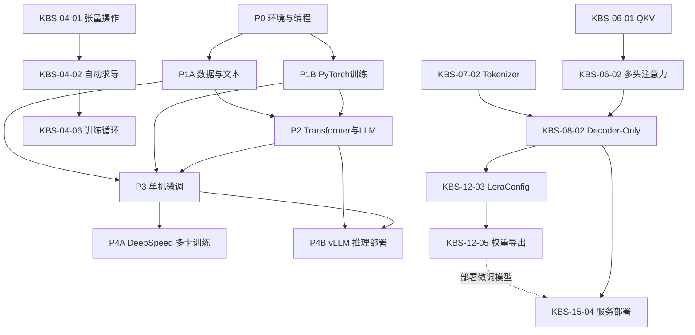

# 大模型学习知识图谱与个性化规划设计（知识点级）

## 0. 文档定位

本设计用于“从零基础到微调和部署推理大模型”的个性化学习 Agent。

- **展示层**：按阶段和板块组织，用户能看懂当前在学什么。
- **决策层**：以 73 个原子知识点为最小单位，Agent 据此诊断、跳过、复习、解锁和排期。
- **原则**：板块不是推荐最小单位；知识点才是。板块仅负责导航、汇总和阶段成就。
- **总理论时长**：71.5h。实际学习应依据用户测评和练习量动态调整。

### 0.1 项目运行原则

- 本文所有板块和知识点必须使用项目既有 ID：板块为 `KB-01` 至 `KB-15`，知识点为 `KBS-xx-xx`。不得引入第二套运行 ID，以保持 SQLite、文章、视频和向量索引的既有绑定。
- **Agent1 只决定学什么**：按学习目标、已掌握状态和 `hard_prerequisite` 计算最小必修子图，并从已解锁知识点中排出阶段顺序。
- **Agent3 决定怎样练**：由编排层向其提供用户实训画像和资料的环境标签，生成本地、云端或替代实训。硬件不会删除核心知识点，也不作为 Agent1 的解锁条件；Agent1 不读取硬件字段。
- 知识资料保持“一知识点一篇主文章”。文章或其资源元数据可标记适用环境，但不因本地/云端而复制出两套正文。

## 1. 分层架构

```text
Phase（阶段）
  └─ KnowledgeBlock（板块，ID 使用 `KB-xx`）
      └─ KnowledgeNode（原子知识点）
          ├─ dependency（依赖边）
          ├─ mastery_check（掌握验证）
          └─ status（用户学习状态）

PracticeMetadata（实训元数据）
  └─ 关联 KnowledgeNode / 学习文章
      ├─ supported_environments（可用环境）
      ├─ preferred_environment（建议环境）
      └─ fallback_mode（替代实训方式）
```

### 1.1 阶段和板块

|阶段|名称|板块|目标|理论时长|
|---|---|---|---|---:|
|P0|环境与编程基座|KB-01 Linux；KB-02 Python|能管理环境、读写和排错代码|13.5h|
|P1|数据与训练基础|KB-03 数据处理；KB-04 PyTorch；KB-05 NLP；KB-07 Tokenizer|能构造模型输入和基础训练流程|18.5h|
|P2|Transformer与LLM原理|KB-06 注意力；KB-08 Transformer；KB-09 LLM特性|理解大模型工作和推理边界|10.5h|
|P3|单机微调实践|KB-10 三阶段训练；KB-11 HuggingFace；KB-12 LoRA/QLoRA；KB-13 训练优化（目标驱动扩展）|完成基础可复现微调，并按目标补充训练优化|19h|
|P4|规模化训练与部署|KB-14 DeepSpeed；KB-15 vLLM|多卡训练或高性能部署|10h|

### 1.2 板块通关逻辑

- 板块内知识点标记为 `required`、`recommended`、`optional`。
- 仅当所有 `required` 节点通过掌握验证，板块才标记为 `mastered`。
- `recommended` 未通过时不阻塞后续，但计划中保留为复习债务。
- `optional` 仅在用户目标匹配时进入学习队列。
- P1 中 KB-03/KB-05/KB-07（数据与文本）和 KB-04（PyTorch）可并行；二者共同为 P2/P3 提供基础。

## 2. 原子知识点目录（73个）

字段说明：`硬前置`表示未掌握不可进入；`推荐前置`表示建议先学；`资源`为实操所需最低条件。

### KB-01 Linux环境与命令行操作（3.5h）

|ID|知识点|h|级别|硬前置|掌握验证|资源|
|---|---|---:|---|---|---|---|
|KBS-01-00|Linux/WSL2/云服务器与终端准备|0|required|-|能进入终端并执行命令|CPU|
|KBS-01-01|Shell命令：cd、ls、mkdir、cp、mv|1|required|KBS-01-00|完成目录创建、复制、移动|CPU|
|KBS-01-02|环境变量配置|1|required|KBS-01-01|设置并验证一个环境变量|CPU|
|KBS-01-03|conda/pip虚拟环境管理|1|required|KBS-01-01|创建环境并安装指定包|CPU|
|KBS-01-04|nvidia-smi显存监控|0.5|recommended|KBS-01-00|识别GPU、驱动和显存占用|NVIDIA GPU|

### KB-02 Python编程基础（10h）

|ID|知识点|h|级别|硬前置|掌握验证|资源|
|---|---|---:|---|---|---|---|
|KBS-02-00|Python/IDE/镜像源环境准备|0|required|KBS-01-03|创建可运行Python项目|CPU|
|KBS-02-01|Python语法|2|required|KBS-02-00|编写条件、循环和模块导入|CPU|
|KBS-02-02|Python数据结构|2|required|KBS-02-01|用列表、字典处理样本数据|CPU|
|KBS-02-03|函数、类与对象|2.5|required|KBS-02-02|封装一个可复用数据处理类|CPU|
|KBS-02-04|文件与异常处理|1.5|required|KBS-02-02|安全读取JSON并处理异常|CPU|
|KBS-02-05|装饰器与生成器|2|recommended|KBS-02-03|解释生成器迭代和简单装饰器|CPU|

### KB-03 数据处理基础（3.5h）

|ID|知识点|h|级别|硬前置|掌握验证|资源|
|---|---|---:|---|---|---|---|
|KBS-03-00|Pandas/NumPy/Matplotlib/re环境准备|0|required|KBS-02-00|成功导入所需库|CPU|
|KBS-03-01|Pandas数据清洗|1|required|KBS-02-02,KBS-03-00|清洗缺失、重复和异常记录|CPU|
|KBS-03-02|JSON/CSV读写与格式转换|0.5|required|KBS-02-04,KBS-03-00|完成JSONL与CSV转换|CPU|
|KBS-03-03|NumPy基本数组运算|1|required|KBS-02-02,KBS-03-00|完成切片、广播和矩阵运算|CPU|
|KBS-03-04|正则表达式文本预处理|1|required|KBS-02-01,KBS-03-00|清洗文本并提取字段|CPU|

### KB-04 深度学习框架PyTorch基础（8.5h）

|ID|知识点|h|级别|硬前置|掌握验证|资源|
|---|---|---:|---|---|---|---|
|KBS-04-00|按CUDA版本安装PyTorch|0|required|KBS-01-03,KBS-02-00|输出torch与CUDA可用状态|GPU建议|
|KBS-04-01|张量操作|1.5|required|KBS-02-02,KBS-03-03,KBS-04-00|完成shape、索引、广播和设备迁移|CPU/GPU|
|KBS-04-02|自动求导机制|1|required|KBS-04-01|解释并执行反向传播|CPU/GPU|
|KBS-04-03|torch.nn模块|1.5|required|KBS-04-01|定义并前向运行一个网络|CPU/GPU|
|KBS-04-04|Dataset/DataLoader数据装载|1|required|KBS-02-03,KBS-03-02,KBS-04-01|构建可批量迭代的数据集|CPU/GPU|
|KBS-04-05|优化器与损失函数|1|required|KBS-04-02,KBS-04-03|选择损失和AdamW并更新参数|CPU/GPU|
|KBS-04-06|训练循环编写|1.5|required|KBS-04-04,KBS-04-05|完成训练、验证和日志循环|CPU/GPU|
|KBS-04-07|checkpoint保存与加载|1|required|KBS-04-06,KBS-02-04|保存、恢复模型和优化器状态|CPU/GPU|

### KB-05 自然语言处理基础概念（3.5h）

|ID|知识点|h|级别|硬前置|掌握验证|资源|
|---|---|---:|---|---|---|---|
|KBS-05-01|分词、词性标注、NER等基础任务|1.5|required|KBS-02-01|区分三类任务及其输入输出|CPU|
|KBS-05-02|BoW、TF-IDF、Word2Vec文本表示|2|recommended|KBS-05-01,KBS-03-03|比较三种表示的优缺点|CPU|

### KB-07 子词切分与分词器Tokenizer（3h）

|ID|知识点|h|级别|硬前置|掌握验证|资源|
|---|---|---:|---|---|---|---|
|KBS-07-00|transformers/tokenizers环境准备|0|required|KBS-01-03,KBS-02-00|加载库并查看版本|CPU|
|KBS-07-01|BPE、WordPiece、SentencePiece原理|1.5|required|KBS-05-01,KBS-07-00|解释子词切分和OOV处理|CPU|
|KBS-07-02|HuggingFace Tokenizer加载与使用|0.5|required|KBS-07-00,KBS-07-01|编码、解码一段文本|CPU|
|KBS-07-03|padding、truncation、max_length|0.5|required|KBS-07-02|生成可送入模型的批处理张量|CPU|
|KBS-07-04|ChatTemplate对话模板格式|0.5|recommended|KBS-07-02|将多轮对话渲染为模型输入|CPU|

### KB-06 注意力机制（2.5h）

|ID|知识点|h|级别|硬前置|掌握验证|资源|
|---|---|---:|---|---|---|---|
|KBS-06-01|Query、Key、Value|1|required|KBS-03-03,KBS-04-01|说明QKV含义和张量形状|CPU|
|KBS-06-02|Self-Attention与Multi-Head Attention|1.5|required|KBS-06-01,KBS-04-03|推导并实现简化注意力计算|CPU/GPU|

### KB-08 Transformer架构（Decoder-Only）（5.5h）

|ID|知识点|h|级别|硬前置|掌握验证|资源|
|---|---|---:|---|---|---|---|
|KBS-08-00|小模型加载与前向实验环境|0|required|KBS-07-02,KBS-04-00|加载GPT-2并得到输出|GPU建议|
|KBS-08-01|Transformer Encoder-Decoder架构|0.5|required|KBS-06-02|说明编码器、解码器和交叉注意力|CPU|
|KBS-08-02|Decoder-Only架构|1|required|KBS-08-01,KBS-06-02|解释因果掩码与自回归生成|CPU|
|KBS-08-03|RMSNorm与残差连接|0.5|required|KBS-08-02|说明稳定训练的作用|CPU|
|KBS-08-04|FFN与SwiGLU|1|required|KBS-08-02|描述Transformer块内数据流|CPU|
|KBS-08-05|RoPE旋转位置编码|1|required|KBS-08-02|解释位置信息注入机制|CPU|
|KBS-08-06|KV Cache机制|1|required|KBS-08-02|解释缓存如何减少生成计算|CPU|
|KBS-08-07|GPT-2前向传播实验|0.5|required|KBS-08-00,KBS-08-03,KBS-08-04,KBS-08-05|检查token到logits流程|GPU建议|

### KB-09 LLM核心特性（2.5h）

|ID|知识点|h|级别|硬前置|掌握验证|资源|
|---|---|---:|---|---|---|---|
|KBS-09-01|涌现能力|0.5|required|KBS-08-02|说明规模与能力变化的关系|CPU|
|KBS-09-02|上下文学习|0.5|required|KBS-08-02|设计few-shot提示词|CPU|
|KBS-09-03|指令遵循|0.5|required|KBS-08-02|区分预训练与指令模型行为|CPU|
|KBS-09-04|逐步推理|0.5|recommended|KBS-09-02|设计可验证的分步提示|CPU|
|KBS-09-05|幻觉问题|0.5|required|KBS-09-01|提出至少两种缓解策略|CPU|

### KB-10 LLM三阶段训练流程（5h）

|ID|知识点|h|级别|硬前置|掌握验证|资源|
|---|---|---:|---|---|---|---|
|KBS-10-01|预训练Pretrain流程与目标|1.5|required|KBS-08-02,KBS-04-06|说明下一个token训练目标|GPU建议|
|KBS-10-02|有监督微调SFT流程与目标|1.5|required|KBS-10-01|设计一条SFT样本|GPU建议|
|KBS-10-03|RLHF流程与目标|2|recommended|KBS-10-02|说明奖励模型和策略优化角色|GPU建议|

### KB-11 HuggingFace生态工具链（4.5h）

|ID|知识点|h|级别|硬前置|掌握验证|资源|
|---|---|---:|---|---|---|---|
|KBS-11-00|transformers/datasets/accelerate/hub环境与缓存|0|required|KBS-01-03,KBS-02-00|配置缓存并完成包导入|CPU|
|KBS-11-01|AutoModel/AutoTokenizer加载|1|required|KBS-11-00,KBS-07-02,KBS-08-02|加载模型和分词器并推理|GPU建议|
|KBS-11-02|datasets：map/filter/shuffle|1.5|required|KBS-11-00,KBS-03-01,KBS-03-02|加工并划分训练数据|CPU|
|KBS-11-03|Trainer与TrainingArguments|2|required|KBS-11-01,KBS-11-02,KBS-04-06|运行可复现实验配置|GPU建议|

### KB-12 参数高效微调（LoRA与QLoRA）（5h）

|ID|知识点|h|级别|硬前置|掌握验证|资源|
|---|---|---:|---|---|---|---|
|KBS-12-00|PEFT环境准备|0|required|KBS-11-00,KBS-04-00|导入peft并完成版本检查|CPU/GPU|
|KBS-12-01|LoRA低秩分解原理|1.5|required|KBS-04-03,KBS-11-03|解释冻结基座与低秩增量|CPU|
|KBS-12-02|Rank/Alpha参数作用|0.5|required|KBS-12-01|说明容量、缩放和显存权衡|CPU|
|KBS-12-03|PEFT LoraConfig配置|1|required|KBS-12-00,KBS-12-02|配置target_modules、r、alpha、dropout|GPU|
|KBS-12-04|QLoRA：NF4、双重量化、分页优化器|1.5|recommended|KBS-12-01,KBS-12-00|说明量化如何降低显存|GPU，建议12GB+；实训需bitsandbytes|
|KBS-12-05|LoRA权重合并与导出|0.5|required|KBS-12-03,KBS-04-07|导出可加载的微调模型|GPU|

### KB-13 PyTorch训练优化（目标驱动扩展，4.5h）

|ID|知识点|h|级别|硬前置|掌握验证|资源|
|---|---|---:|---|---|---|---|
|KBS-13-00|AMP环境准备|0|recommended|KBS-04-00|确认设备支持AMP|GPU|
|KBS-13-01|梯度累积|1|recommended|KBS-04-06|实现等效大batch训练|GPU|
|KBS-13-02|AMP混合精度训练|1.5|recommended|KBS-13-00,KBS-04-06|使用autocast和scaler训练|GPU|
|KBS-13-03|梯度检查点|1|recommended|KBS-04-06|启用后对比显存与速度|GPU|
|KBS-13-04|Warmup与余弦退火调度|1|recommended|KBS-04-05,KBS-04-06|配置并记录学习率曲线|CPU/GPU|

### KB-14 分布式训练DeepSpeed（5h）

|ID|知识点|h|级别|硬前置|掌握验证|资源|
|---|---|---:|---|---|---|---|
|KBS-14-00|DeepSpeed、多GPU与ds_config环境|0|optional|KBS-01-03,KBS-04-00|识别多卡并完成安装|2+ GPU|
|KBS-14-01|ZeRO-1/2/3策略|1.5|optional|KBS-14-00,KBS-13-01,KBS-13-02|按显存需求选择阶段|2+ GPU|
|KBS-14-02|数据并行与模型并行|1.5|optional|KBS-14-01|解释两种并行的通信差异|2+ GPU|
|KBS-14-03|编写ds_config并启动训练|2|optional|KBS-14-01,KBS-14-02,KBS-11-03|启动并验证分布式训练|2+ GPU|

### KB-15 模型推理部署vLLM（5h）

|ID|知识点|h|级别|硬前置|掌握验证|资源|
|---|---|---:|---|---|---|---|
|KBS-15-00|vLLM/PyTorch/CUDA/显存环境|0|required|KBS-01-03,KBS-04-00|安装并运行vLLM诊断|NVIDIA GPU，建议16GB+|
|KBS-15-01|贪心搜索与束搜索|1|required|KBS-08-02|比较两种解码策略|CPU|
|KBS-15-02|Top-p/Top-k/Temperature|1|required|KBS-15-01|调参并解释输出变化|CPU/GPU|
|KBS-15-03|PagedAttention与Continuous Batching|1.5|required|KBS-08-06,KBS-15-00|解释吞吐与显存优化|GPU|
|KBS-15-04|vLLM加载与部署参数|1.5|required|KBS-15-00,KBS-15-02,KBS-15-03|启动服务并配置gpu_memory_utilization|GPU|

## 3. 图谱边与解锁规则

### 3.1 必须建模的边类型

|类型|含义|示例|规划行为|
|---|---|---|---|
|`hard_prerequisite`|未掌握不能学习目标节点|KBS-04-01 -> KBS-04-02|目标节点保持`locked`|
|`recommended_prerequisite`|先学更高效，但可跳过|KBS-05-02 -> KBS-07-01|标记提示，不阻塞|
|`contextual_relation`|对照或相关知识|KBS-05-02 <-> KBS-07-01|用于解释和复习推荐|
|`goal_condition`|仅在目标匹配时需要|KBS-12-05 -> KBS-15-04|部署微调模型时激活|

> **硬件处理边界**：GPU、显存、云端可用性等不是知识点图谱的解锁边。它们由 Agent3 读取用户硬件与文章标签后，选择本地实训、云端实训或替代练习；学习该知识点本身不因此被锁定。

### 3.2 关键跨板块边

```text
KBS-03-02 + KBS-03-04 -> KBS-11-02 -> KBS-11-03 -> KBS-12-03
KBS-07-02 + KBS-07-03 -> KBS-10-02 -> KBS-11-03 -> KBS-12-03
KBS-04-01 -> KBS-06-01 -> KBS-06-02 -> KBS-08-02 -> KBS-08-06 -> KBS-15-03
KBS-04-06 -> KBS-13-01/KBS-13-02/KBS-13-03/KBS-13-04 -> KBS-14-01
KBS-12-03 -> KBS-12-05 -> KBS-15-04          # 仅部署微调模型时
KBS-08-02 -> KBS-15-01 -> KBS-15-02 -> KBS-15-04 # 部署任何自回归模型时
KBS-07-04 -. recommended_prerequisite .-> KBS-09-02
KBS-07-04 -. goal_condition(chat_sft) .-> KBS-10-02
```

LoRA 实操还应建模一条推荐边：

```text
KBS-10-02（SFT流程） -. recommended_prerequisite .-> KBS-12-03（LoraConfig）
```

这条关系帮助用户在开始 LoRA 实训前理解 SFT 数据格式、训练目标与验证方式，但不要求先完成完整预训练流程，避免无谓拉长微调主路径。

QLoRA 的 `bitsandbytes` 不是基础 LoRA 的前置条件。它作为 `KBS-12-04` 的实训环境标签，由 Agent3 仅在生成 QLoRA 实训时处理；`KBS-12-00` 只负责 PEFT 的通用环境准备。

KB-13 是训练优化扩展，不阻塞基础 LoRA 微调。仅当目标包含高效微调、稳定训练或生产化训练时，Agent1 才将 KB-13 的推荐节点提升进入学习队列。

ChatTemplate（KBS-07-04）不阻塞一般的上下文学习或一般 SFT：它与 KBS-09-02 是推荐关系；仅当目标是 `chat_sft` 时，才以 `goal_condition(chat_sft)` 进入对话 SFT 的学习路径。

## 4. 数据结构建议

### 4.1 知识节点

```json
{
  "id": "KBS-04-06",
  "name": "训练循环编写",
  "module_id": "KB-04",
  "phase_id": "P1",
  "estimated_hours": 1.5,
  "difficulty": "intermediate",
  "default_role": "required",
  "mastery_check": "完成训练、验证和日志循环",
  "outcomes": ["可训练基础模型", "可理解Trainer流程"]
}
```

### 4.2 实训元数据（Agent3 专用）

```json
{
  "node_id": "KBS-12-04",
  "supported_environments": ["local_nvidia_gpu", "cloud_gpu"],
  "preferred_environment": "local_nvidia_gpu",
  "fallback_mode": "cloud_gpu_or_theory",
  "practice_requirements": {"packages": ["bitsandbytes"], "min_vram_gb": 12}
}
```

实训元数据不属于 `KnowledgeNode`，不参与知识点解锁。编排层只向 Agent3 提供该元数据和用户实训画像。

### 4.3 依赖边

```json
{
  "source_id": "KBS-04-01",
  "target_id": "KBS-04-06",
  "type": "hard_prerequisite",
  "reason": "训练循环必须处理张量形状、设备和批数据",
  "weight": 1.0
}
```

### 4.4 运行时数据职责

|数据位置|保存内容|运行职责|
|---|---|---|
|`knowledge_subtopics.prerequisites`|仅 `hard_prerequisite` 的知识点 ID|Agent1 解锁和阶段排序的唯一硬约束|
|`data/graph_data`|硬前置、推荐前置、关联关系和目标条件|路径解释、可视化、复习推荐和图谱校验|
|文章/资源实训元数据|适用环境、建议环境、无 GPU 替代方式等标签|编排层仅提供给 Agent3，用于生成本地、云端或替代实训|

不得将 `recommended_prerequisite`、`contextual_relation` 或环境标签写入 `knowledge_subtopics.prerequisites`，以免把推荐内容误变为阶段阻塞条件。

### 4.5 学习画像、实训画像和学习计划

```json
{
  "agent1_profile": {
    "python_level": 0,
    "linux_level": 0,
    "deep_learning_level": 0,
    "nlp_level": 0,
    "transformer_level": 0,
    "goal": "finetune",
    "available_hours_per_week": 6,
    "learning_preference": "balanced"
  },
  "practice_profile": {
    "os": "windows",
    "gpu_count": 1,
    "vram_gb": 12
  },
  "plan_item": {
    "node_id": "KBS-04-06",
    "phase": 2,
    "status": "required",
    "estimated_hours_adjusted": 2.0,
    "priority": 90,
    "reason": "SFT和Trainer的硬前置",
    "assessment_score": null
  }
}
```

`agent1_profile` 是 Agent1 唯一可查询和返回的用户画像，不包含操作系统、GPU 数量或显存。`practice_profile` 由编排层与当前知识点的实训元数据一起直接提供给 Agent3；Agent1 的查询/API 不返回该对象。

状态枚举：`locked`、`diagnostic`、`required`、`review`、`optional`、`completed`。

## 5. 个性化生成规则

1. 通过测评、既往项目和自评初始化 Python、Linux、深度学习、NLP、Transformer 能力等级（0-5）。
2. 根据目标选择终点：`finetune` 选 KBS-12-03/05；`deploy` 选 KBS-15-04；`distributed_training` 选 KBS-14-03；`theory` 选 KBS-08-07 与 LLM节点。
3. 从终点反向遍历所有 `hard_prerequisite`，得到用户的最小必修子图。
4. 对测评达标节点标记 `review`；未达标的硬依赖标记 `required`；`recommended_prerequisite` 进入复习债务或推荐队列，但不阻塞；非目标节点标记 `optional`。
5. 在已解锁节点中，按目标相关度、依赖紧急度、预计收益、用户偏好和时长排序。不能按板块序号或 `sequence_index` 机械串行排期。
6. 将节点聚合为板块和周计划。每周计划应至少包含：新知识点、一个练习产出、一个复习节点和一个掌握验证。
7. 每次验证更新节点状态，并重新计算可解锁子图，而不是固定执行初始路线。
8. Agent1 只输出当前知识点、阶段理由和学习目标。编排层将该结果、`practice_profile` 与文章实训元数据直接提供给 Agent3；Agent3 决定本地、云端或替代实训方案，不回写 Agent1 的知识点解锁状态。

## 6. 三类初始模板

### A类：有Python基础，无NLP/深度学习经验

- 初始设置：KBS-02-01 至 KBS-02-05 进入`diagnostic`；Linux、数据、PyTorch、NLP、Tokenizer保持必修。
- 主路径：KB-01 -> KB-03与KB-04并行 -> KB-05/KB-07 -> KB-06/KB-08/KB-09 -> KB-10/KB-11/KB-12 -> KB-15。
- KBS-13、KBS-14-00 至 KBS-14-03默认`recommended`或`optional`；KBS-10-03、KBS-12-04先`recommended`。
- 理论时长：约63-66h。

### B类：完全零基础

- 初始设置：全部P0/P1核心节点为`required`，后续节点先`locked`。
- 主路径：KB-01 -> KB-02 -> KB-03与KB-04 -> KB-05/KB-07 -> KB-06/KB-08/KB-09 -> KB-10/KB-11/KB-12 -> KB-15。
- 目标包含高效微调、稳定训练或生产化训练时，KB-13 进入推荐队列；学习目标包含分布式训练时，KBS-14-00 至 KBS-14-03进入学习队列。Agent3 再依据硬件生成多卡、云端或替代实训。KBS-10-03和KBS-12-04在完成LoRA后进入学习队列。
- 理论时长：71.5h；加练习和排错建议110-140h。

### C类：有CNN/RNN基础，未接触大模型/Transformer

- 初始设置：KBS-02-00至KBS-02-05、KBS-04-01至KBS-04-06进入`diagnostic`；KBS-04-04、KBS-04-07、KBS-13-00至KBS-13-04建议复习。
- 主路径：KB-01环境核查 -> KB-05/KB-07 -> KB-06/KB-08/KB-09 -> KB-10/KB-11/KB-12 -> KB-15。
- KBS-05-02、KBS-10-03、DS节点默认`recommended`或`optional`。
- 理论时长：约50-55h。

## 7. Mermaid总览



## 8. 实现检查清单

- 73个节点均有唯一ID、时长、模块、阶段和掌握验证。
- 依赖边必须带类型，禁止将“关联知识”误作硬前置。
- `knowledge_subtopics.prerequisites` 只存硬前置；推荐、关联和目标条件留在图谱中。
- 模块通关只检查其`required`节点；节点状态优先于板块状态。
- 根据目标、测评和掌握状态动态计算路径，不将A/B/C模板写死为唯一顺序。
- 硬件只影响 Agent3 的实训呈现方式，不影响 Agent1 对核心知识点的解锁与排期。
- 将`reason`返回给前端，让用户知道为何当前学习某一知识点。
